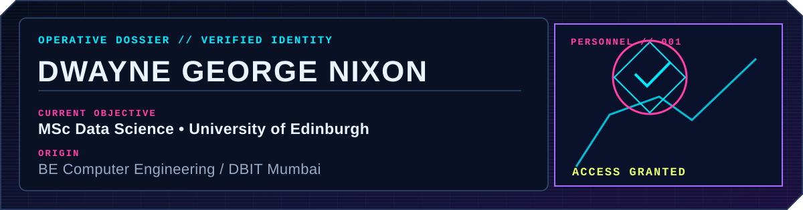
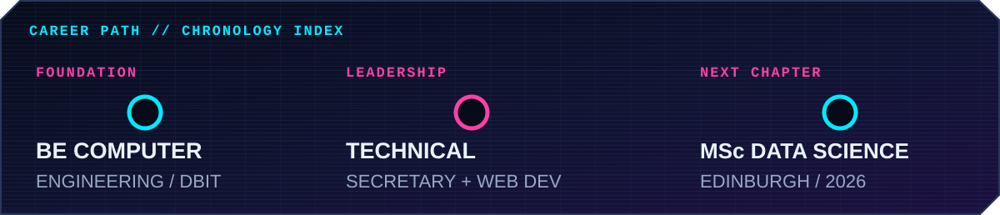
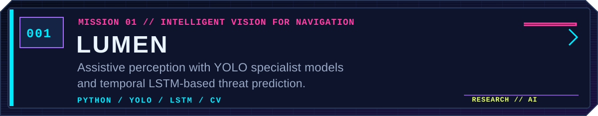
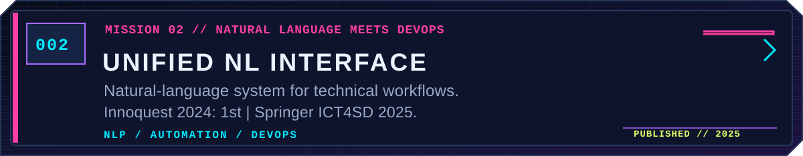
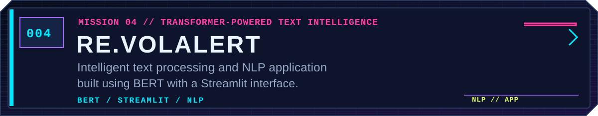
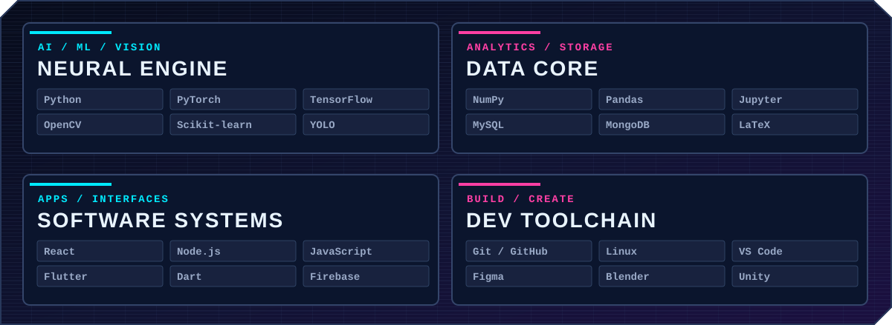
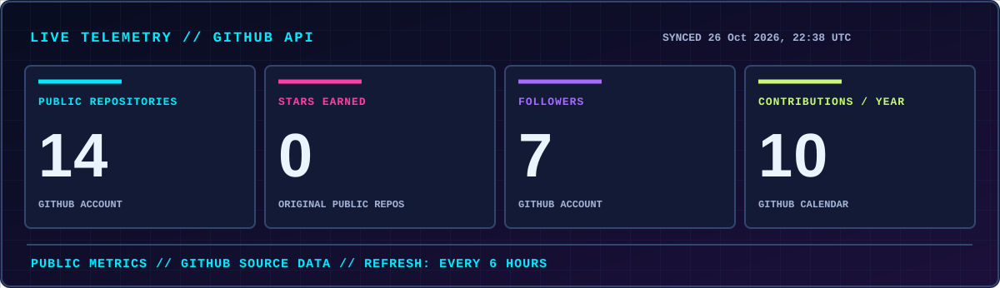
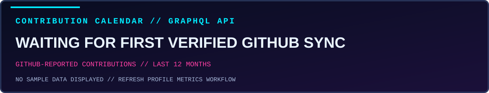
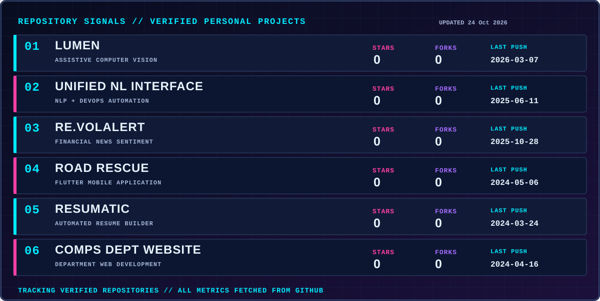
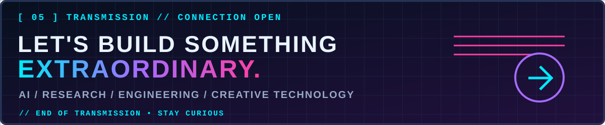

<!-- DWAYNE NIXON // NEON PROFILE OS — real projects only; telemetry updates through GitHub Actions -->

<a href="https://github.com/DwayneNixon?tab=repositories">[ // EXPLORE REPOSITORIES ]</a>　<a href="https://github.com/DwayneNixon">[ // GITHUB PROFILE ]</a>

**`> IDENTITY CONFIRMED`** — I'm Dwayne, an MSc Data Science student at the **University of Edinburgh** and a Computer Engineering graduate from **Don Bosco Institute of Technology, Mumbai**.

I build **AI and data science solutions** spanning computer vision, natural language processing, software engineering, and assistive technology. I was previously the **Technical Secretary** of my college's student council and worked on the Computer Department's website.

**`// DEPLOYED PROJECTS — VERIFIED WORK I BUILT OR CONTRIBUTED TO`**

<b>▸ OPEN COLLABORATIVE MISSIONS — WITH VERIFIED REPO CREDITS</b>

| PROJECT | MY INVOLVEMENT / FOCUS |
| :-- | :-- |
| [**Road Rescue**](https://github.com/DwayneNixon/road_rescue_app) | Named team member · Flutter + Mapbox mobile application |
| [**Resumatic**](https://github.com/DwayneNixon/Resumatic) | Named team member · Automated resume builder · Innoquest 2023 — 3rd place |
| [**DBIT Computer Department Website**](https://github.com/DwayneNixon/CompsDeptWebsite) | Listed on the development team · Website engineering |

<b>▸ OFF-GRID PROJECT — AGROSHIELD</b>

**AgroShield** — agricultural CNN project with **93% accuracy**; **2nd place at Innoquest 2025**. This is one of my projects, but no public GitHub repository is linked, so no GitHub activity or stars are attributed to it.

**`> LIVE GITHUB UPLINK`** — Figures below come from GitHub's own API, refreshed automatically by [this workflow](https://github.com/DwayneNixon/DwayneNixon/actions/workflows/refresh-profile-metrics.yml) every six hours. They are **real counts**, not mock data; the timestamp shows the most recent successful sync. GitHub may briefly cache the images.

**`// REPOSITORY SIGNALS`** — Only the six public projects linked above are tracked here. **Stars, forks and last push dates are fetched from GitHub**, not invented or estimated.

[**VIEW MY LIVE ACTIVITY ON GITHUB ↗**](https://github.com/DwayneNixon)

**`> CHANNEL OPEN`** — Open to conversations about AI, accessibility, computer vision, NLP and research.

[**EXPLORE MY PROJECTS ↗**](https://github.com/DwayneNixon?tab=repositories)　//　[**VIEW MY GITHUB ↗**](https://github.com/DwayneNixon)

`© 2026 DWAYNE GEORGE NIXON // NEON PROFILE OS // STAY CURIOUS`

