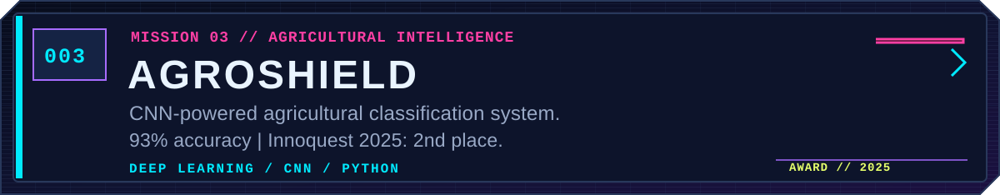

<!--
  DWAYNE NIXON // NIGHT CITY DOSSIER
  A self-hosted, cyberpunk-inspired GitHub profile.
  Graphic panels are text-based SVGs in ./assets.
  No third-party stats renderers or external fonts required.
-->

  
   
  
  

 

**`> INITIALIZING OPERATOR DOSSIER...`**

I'm **Dwayne George Nixon**, an MSc Data Science student at the **University of Edinburgh**, and a Computer Engineering graduate of **Don Bosco Institute of Technology, Mumbai**.

I design and build intelligent systems that bridge **machine learning, computer vision, natural language processing, and practical software engineering**. My work spans assistive AI, automation, research, mobile applications, and creative technology.

Previously: **Technical Secretary**, **Computer Department Web Developer Intern**, and coordinator of large college events. I enjoy the intersection of research, shipping real software, and leading teams.

 

<!-- The following featured projects have no verified public source repository linked here. -->

<b>▸ ACCESS ADDITIONAL MISSIONS // SIDE QUESTS</b>

 

| OPERATIVE FILE | DETAILS |
| :-- | :-- |
| [`ROAD_RESCUE`](https://github.com/DwayneNixon/road_rescue_app) | Flutter + Mapbox mobile application |
| [`RESUMATIC`](https://github.com/DwayneNixon/Resumatic) | Innoquest 2023 — 3rd place |
| [`COMPS_DEPT_WEB`](https://github.com/DwayneNixon/CompsDeptWebsite) | Department website development |
| `VOTING_DAPP` | Decentralized voting application using Solidity |
| `TEKNACK_GAMES` | Sengoku Yami and Wrath of the Shogun |

 

`MODEL TRAINING`　·　`DATA PIPELINES`　·　`VISION SYSTEMS`　·　`FULL-STACK APPS`

 

**`SYSTEM NOTE //`** Metrics above are a *snapshot*, not live GitHub analytics.  
**[VIEW LIVE CONTRIBUTIONS & REPOSITORIES →](https://github.com/DwayneNixon)**

 

**`> CHANNEL OPEN`** — Always interested in machine learning, research, accessibility, creative technology, and ambitious ideas.

[**EXPLORE MY CODE**](https://github.com/DwayneNixon?tab=repositories)　//　[**VIEW MY PROFILE**](https://github.com/DwayneNixon)

`© 2026 DWAYNE GEORGE NIXON // NO SIGNAL LOST // STAY CURIOUS`

