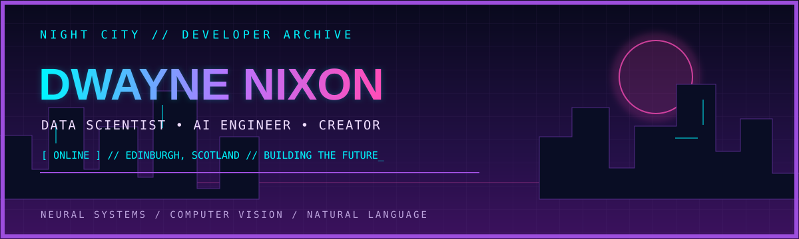
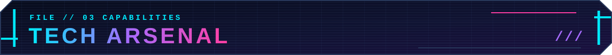

<div align="center">



<br/>


</div>


```yaml
alias: Dwayne George Nixon
handle: DwayneNixon
location: Edinburgh, Scotland
current_mission: MSc Data Science | University of Edinburgh
origin: BE Computer Engineering | DBIT, Mumbai
specializations: [Machine Learning, Computer Vision, NLP, Intelligent Systems]
previous_roles: [Technical Secretary, Web Developer Intern]
status: "always learning // always building"
```

I'm **Dwayne George Nixon**, a Data Science postgraduate at the **University of Edinburgh** with a background in Computer Engineering from **Don Bosco Institute of Technology, Mumbai**.

I build intelligent solutions at the intersection of **machine learning, computer vision, natural language processing, and software engineering**. From navigation assistance to natural-language interfaces, I enjoy transforming research and ambitious ideas into software that solves real problems.

Beyond coding, I've served as **Technical Secretary** of my student council, helped develop my department's website as a **Web Developer Intern**, and coordinated technical and cultural events.

> `NEURAL LINK //` Curiosity drives the research. Engineering makes it real.


<table>
<tr><td width="50%" valign="top">

### `MISSION_01` · LUMEN
**Intelligent Vision for Navigation Assistance**

An assistive vision system using specialized object detection and temporal threat prediction to help make navigation safer.

`Python` · `YOLO` · `LSTM` · `Computer Vision`

</td><td width="50%" valign="top">

### `MISSION_02` · Unified NL Interface
**Natural Language Meets DevOps**

A natural-language interface for technical workflows. **1st place — Innoquest 2024**, with research published in **Springer ICT4SD 2025**.

`NLP` · `Automation` · `DevOps` · `Research`

</td></tr>
<tr><td width="50%" valign="top">

### `MISSION_03` · AgroShield
**AI for Agricultural Intelligence**

A CNN-based agricultural classification project achieving **93% accuracy** and **2nd place — Innoquest 2025**.

`Deep Learning` · `CNN` · `AgriTech`

</td><td width="50%" valign="top">

### `MISSION_04` · Re.volAlert
**Transformer-Based Text Intelligence**

An NLP application exploring intelligent text processing with transformer models.

`BERT` · `Streamlit` · `NLP`

</td></tr>
</table>

<details>
<summary><b>▸ UNLOCK SIDE MISSIONS</b></summary>

| Project | Description |
| :--- | :--- |
| **Road Rescue** | Flutter + Mapbox mobile application |
| **Resumatic** | Resume-oriented project; 3rd place at Innoquest 2023 |
| **Voting DApp** | Decentralized voting application built with Solidity |
| **Sengoku Yami / Wrath of the Shogun** | Games developed for Teknack |

</details>



<div align="center">

**`AI // MACHINE LEARNING`**


**`DATA // INFRASTRUCTURE`**


**`DEVELOPMENT // SYSTEMS`**


**`TOOLS // CREATIVE`**


<sub>Additional loadout: NumPy · Pandas · Jupyter · HTML/CSS · LaTeX · C · Java</sub>

</div>


<div align="center">


</div>


<div align="center">

### `> INCOMING TRANSMISSION_`

**Interested in intelligent systems, research, creative tech, or ambitious ideas?**

Explore my work and get in touch on GitHub.

<a href="https://github.com/DwayneNixon?tab=repositories"></a>
<a href="https://github.com/DwayneNixon"></a>

<br/><br/>

<sub><code>© 2026 DWAYNE GEORGE NIXON // END OF TRANSMISSION // STAY CURIOUS</code></sub>

</div>
